# NeuroQ-ASD — Quantum Machine Learning for Autism Classification

Collaborative repository for the two-member team participating in **Quantum Hack Day Kochi | Qiskit Fall Fest 2026 (QFF26)** at TinkerSpace, Kochi.

**Challenge Track:** Challenge 02 · Quantum Machine Learning | Healthcare
**Task:** Classify Autism Spectrum Disorder (ASD) vs. Typical Control from structural brain MRI, comparing quantum kernel / variational circuits against classical baselines.

---

## Screenshots

### Web Dashboard — Home

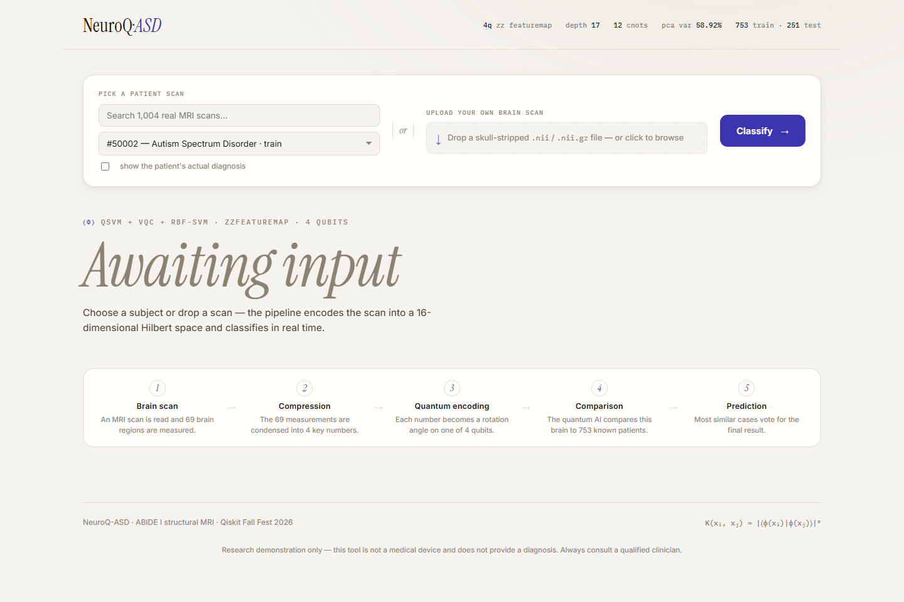

The NeuroQ-ASD dashboard on startup. The header chips report live circuit metrics pulled from `/api/info` (4 qubits, ZZFeatureMap, depth 17, 12 CNOTs, 58.92% PCA variance retained, 753 train / 251 test split). The command bar offers two input modes — pick any of the **1,004 ABIDE subjects** or **drag-and-drop a skull-stripped `.nii` / `.nii.gz` scan** — and the step strip explains the five pipeline stages in plain language.

### Live Classification — Verdict

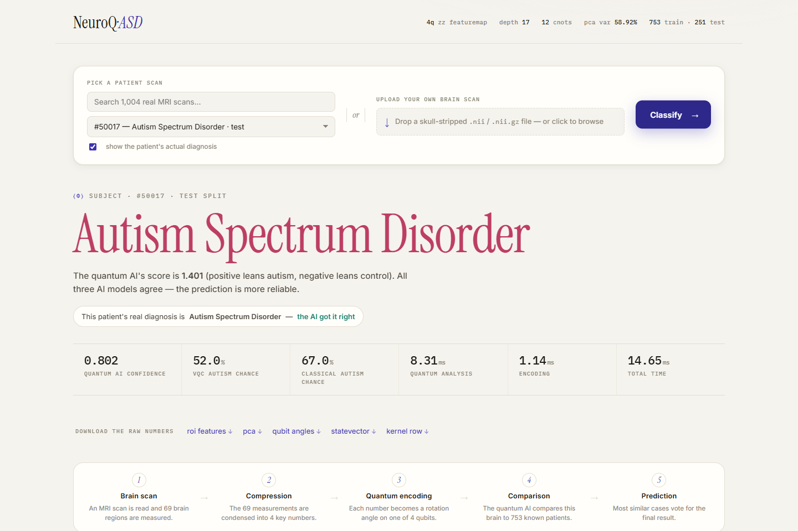

Result of classifying held-out **test subject #50017**. The Quantum Kernel SVM predicts **Autism Spectrum Disorder** (decision score 1.401, sigmoid confidence 0.802) and **all three models agree** (QSVM + VQC + classical RBF-SVM). With ground truth revealed, the UI confirms *"the AI got it right"*. The spec row reports per-model probability and stage latency: quantum inference in **8.31 ms**, total **14.65 ms**.

### Brain MRI — Three Views of an Uploaded Scan

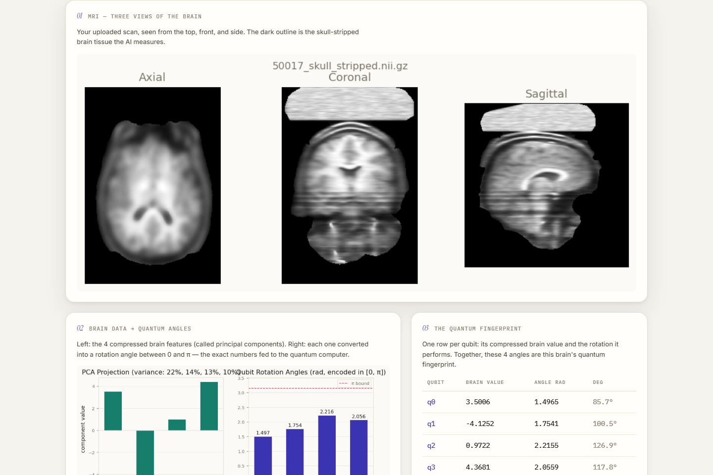

Drag-and-drop upload of `50017_skull_stripped.nii.gz` (3.1 MB). The server resamples the scan onto the **Harvard-Oxford atlas grid** (nibabel + `scipy.map_coordinates` trilinear resampling, ~650 ms on CPU) and renders **axial / coronal / sagittal mid-slices** of the skull-stripped brain volume — the tissue the pipeline actually measures. Below it, the scan's 69 ROI means are compressed to the 4 PCA components and converted to qubit rotation angles.

### Uploaded Scan — Verdict

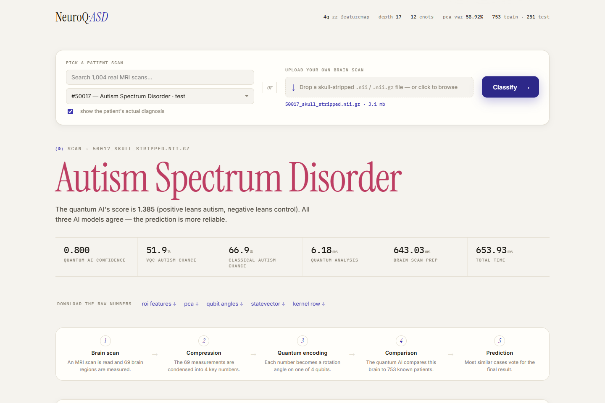

The same scan classified end-to-end through the live pipeline: **Autism Spectrum Disorder**, score 1.385, unanimous 3-model consensus — matching the parquet-computed encoding of the same subject (score 1.401) and validating the MRI feature-extraction path. Brain-scan prep took 643 ms; the quantum kernel comparison against 753 training subjects took 6.18 ms.

### Quantum Encoding — Figures Panel

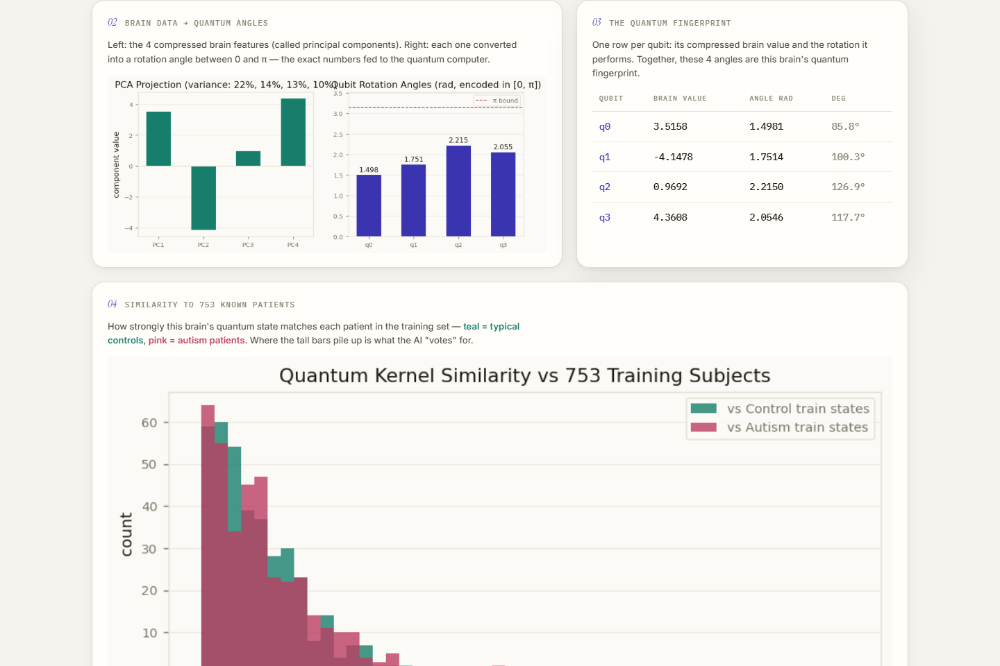

The interpretability panel rendered per classification: **(02)** the 4 PCA projections and the resulting rotation angles clamped to `[0, π]`; **(03)** the per-qubit "quantum fingerprint" table; **(04)** the kernel-fidelity histogram `K(x, x_train) = |⟨φ(x)|φ(x_train)⟩|²` of this brain against all 753 training states — teal = controls, pink = autism; **(05)** the actual 4-qubit ZZFeatureMap circuit.

Full-page result view: [`reports/screenshots/ui_result_full.png`](reports/screenshots/ui_result_full.png)

---

## Project Specifications

### Dataset

| Property | Value |
| --- | --- |
| Source | **ABIDE I** (Autism Brain Imaging Data Exchange), structural T1 MRI, ~17 acquisition sites |
| Cohort | **1,004 subjects** — 500 autism (`DX_GROUP=1`), 504 typical controls (`DX_GROUP=2`), near-balanced |
| Scans | Skull-stripped NIfTI-1 `.nii.gz`, float32, **mixed voxel geometries** (sites were not resampled to a common grid) |
| Features | **69 ROI mean intensities** — Harvard-Oxford cortical (48) + subcortical (21) atlas, z-normalized within brain mask |
| Phenotypic labels | `Phenotypic_V1_0b_preprocessed1.csv` (`SUB_ID`, `DX_GROUP`, `AGE_AT_SCAN`, `SEX`, `SITE_ID`, `FIQ`) |
| Split | Stratified 75/25 → **753 train / 251 test**, `random_state=42` |

### Preprocessing & Encoding

| Stage | Transform | Output |
| --- | --- | --- |
| ROI extraction | Resample scan to atlas grid → per-region z-scored means | `x ∈ ℝ⁶⁹` |
| Standardization | `StandardScaler` (train-fit) | zero mean, unit variance |
| Compression | `PCA(n_components=4)` | `z ∈ ℝ⁴`, **58.92% variance retained** (21.8 / 14.4 / 12.9 / 9.7%) |
| Phase-safe scaling | `MinMaxScaler → [0, π]` + clip | 4 qubit rotation angles |
| Encoding | `ZZFeatureMap` binds angles → 16-dim Hilbert space | `|φ(x)⟩` statevector |

### Quantum Architecture

| Component | Specification | Metrics |
| --- | --- | --- |
| Feature map | `ZZFeatureMap`, 4 qubits, reps=1, **full entanglement** | depth **17**, **12** CNOTs, 10 P, 4 H |
| Quantum kernel | `K(xᵢ, xⱼ) = |⟨φ(xᵢ)|φ(xⱼ)⟩|²` statevector fidelity → SVC `kernel="precomputed"`, C=1.0 | 753×753 Gram matrix |
| VQC | `ZZFeatureMap` + `RealAmplitudes` (linear entanglement, reps=1), COBYLA maxiter=25, subsample=100, ⟨Z₀⟩ measurement | depth **15**, **9** CNOTs; final MSE loss 0.2423 |
| Simulator | Qiskit 2.x `Statevector` / `AerSimulator` (ideal, no noise model) | — |

### Inference Latency (single scan)

| Stage | Subject lookup | Uploaded `.nii.gz` |
| --- | --- | --- |
| ROI extraction / encode | ~1 ms | ~650 ms |
| Quantum kernel inference | ~6–8 ms | ~6 ms |
| **Total** | **~15 ms** | **~840 ms** |

---

## Benchmark Results

Measured on the identical held-out test set (N_test = 251), `python -m src.evaluate`:

| Model | Accuracy | Balanced Acc | F1-Score | ROC-AUC | Train Time (s) | Qubits | Circuit Depth | CNOTs |
| --- | --- | --- | --- | --- | --- | --- | --- | --- |
| Logistic Regression | 0.5657 | 0.5655 | 0.5322 | 0.584 | 0.02 | - | - | - |
| Classical SVM (Linear) | 0.5179 | 0.5166 | 0.2754 | 0.576 | 0.02 | - | - | - |
| Classical SVM (RBF) | 0.5498 | 0.5496 | 0.5191 | 0.587 | 0.02 | - | - | - |
| Random Forest | 0.5378 | 0.5379 | 0.5433 | 0.597 | 0.36 | - | - | - |
| Quantum Kernel SVM (Linear) | 0.5777 | 0.5778 | 0.5891 | 0.615 | 2.55 | 4 | 11 | 6 |
| **Quantum Kernel SVM (Full Entanglement)** | **0.5976** | **0.5977** | **0.6070** | **0.642** | 2.21 | 4 | 17 | 12 |
| Variational Quantum Classifier (VQC) | 0.5060 | 0.5055 | 0.4414 | 0.516 | 5.67 | 4 | 15 | 9 |

The fully-entangled quantum kernel is the strongest model on every metric — consistent with published ~60–65% cross-site accuracy on ABIDE structural MRI (site-scanner confounds cap performance). **No quantum advantage is claimed** — the point is a sound problem mapping, purposeful circuit design, and transparent comparison.

| 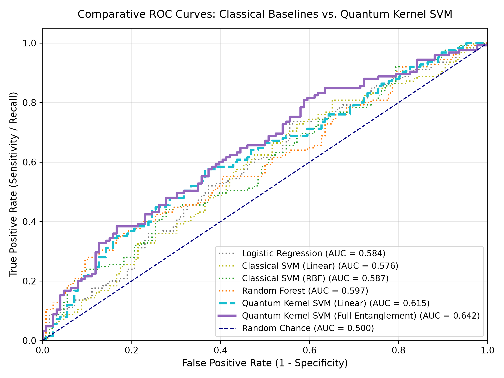 | 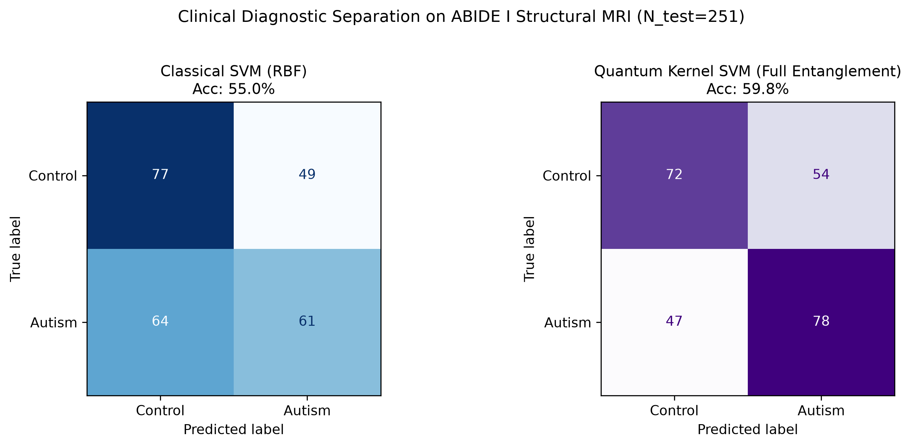 |
| --- | --- |
| ROC curves — QSVM (full) dominates with AUC 0.642 vs best classical 0.597. | Confusion matrices — QSVM (full) recovers more autism cases (78 vs 61) than RBF-SVM at similar control recall. |

| 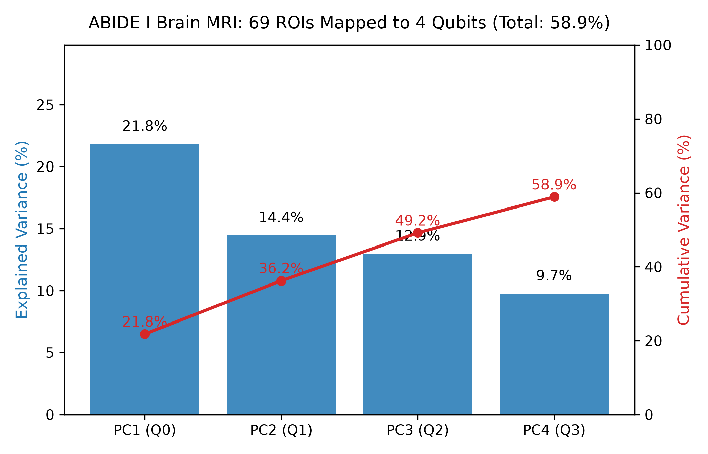 | 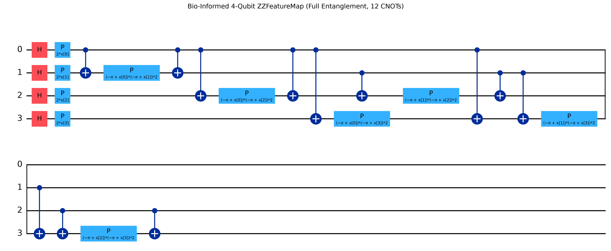 |
| --- | --- |
| PCA → qubit budget: 4 components retain 58.9% of 69-ROI variance. | Transpiled 4-qubit `ZZFeatureMap` (full entanglement): H layer + P rotations + 12 CNOT entanglers. |

### Brain → Quantum State, per Classification

| 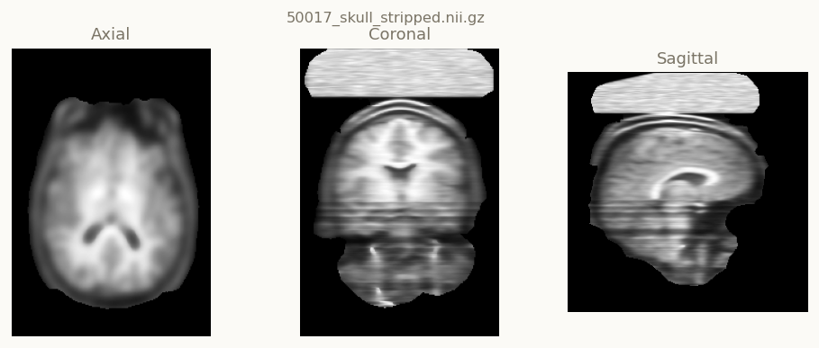 | 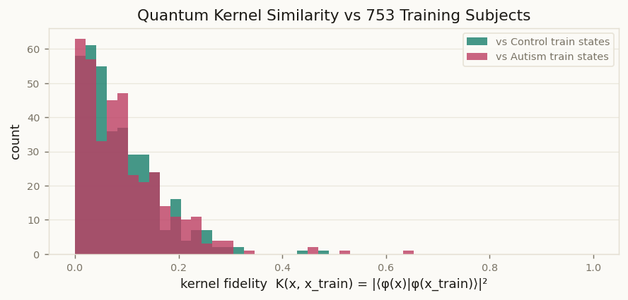 |
| --- | --- |
| Axial / coronal / sagittal slices of an uploaded skull-stripped scan. | Fidelity of the scan's encoded state vs all 753 training states — the separation the SVM exploits. |

---

## Real-Time Classification Web App

Flask backend + dashboard that classifies MRI scans live through the quantum kernel pipeline.

```bash
pip install -r requirements.txt
python app/server.py            # http://127.0.0.1:5000  (first run fits + persists models/)
python app/server.py --retrain  # force rebuild of models/pipeline.joblib
```

- **Input:** pick any of the 1,004 ABIDE subjects from the parquet, or drag-and-drop a skull-stripped `.nii` / `.nii.gz` scan (CPU ROI extraction via nibabel + `scipy.map_coordinates`, Harvard-Oxford atlas from the local nilearn cache — set `ATLAS_DIR` to override).
- **Output:** three-model consensus — QSVM (full entanglement), VQC (RealAmplitudes + COBYLA), and classical RBF-SVM — plus per-stage figures: MRI slices, ROI profile, PCA→qubit angles, 16-state statevector magnitudes/phases, per-qubit Bloch vectors, kernel-fidelity histogram, VQC loss curve, circuit diagram.
- **CSV exports:** `roi_features`, `pca_components`, `qubit_angles`, `statevector`, `kernel_similarities` — via dashboard buttons or `GET /api/export/<job_id>/<kind>.csv`.

| Endpoint | Description |
| --- | --- |
| `GET /api/info` | Circuit metrics, PCA variance, dataset summary |
| `GET /api/subjects` | All subjects with label + train/test split |
| `POST /api/classify` | `{"subject_id": N}` → full quantum payload + figures |
| `POST /api/classify/scan` | multipart `file=.nii[.gz]` → extraction + payload |
| `GET /api/export/<job>/<kind>.csv` | CSV download of encoding artefacts |

### Repository Layout

```
app/            Flask server (app/server.py) + static dashboard (html/css/js)
src/            Pipeline: mri_features, data_loader, quantum_kernel, vqc_classifier,
                classical_baselines, evaluate, inference, quantum_viz, visualize
data/           abide_roi_features.parquet (69 ROI features × 1,004 subjects) + phenotypic CSV
notebooks/      demo.ipynb — end-to-end walkthrough
reports/        Benchmark figures + UI/figure screenshots used in this README
context/        Challenge brief, architecture math, contracts, sprint board
skills/ · agent-skills/   Modular agent skills for each pipeline stage
tools/          capture.js — headless-Chrome screenshot helper (puppeteer-core)
```

---

## Shared Team Architecture

This repository maintains shared context, operational contracts, and agent skills to coordinate development across the team:

- **[`context/`](context/README.md):** Shared operational and technical single source of truth:
  - [`project_brief.md`](context/project_brief.md): Challenge background, scope, and mandatory deliverables.
  - [`team_contracts.md`](context/team_contracts.md): Member ownership matrix, data schemas, API contracts, and sync timeline.
  - [`technical_architecture.md`](context/technical_architecture.md): Mathematical formulations, feature map (`ZZFeatureMap`), quantum kernel, and VQC architecture.
  - [`evaluation_and_judging.md`](context/evaluation_and_judging.md): Judging rubric alignment and defense strategy.
  - [`roadmap_and_sprint_board.md`](context/roadmap_and_sprint_board.md): Sprint 1 and Sprint 2 task tracking.
- **[`skills/`](skills/README.md) & [`agent-skills/`](agent-skills/README.md):** Modular agent skills covering:
  - `clinical-data-prep-and-baseline`: Tabular data preprocessing, PCA ($d=4$), scaling to $[0, \pi]$, classical baselines.
  - `qml-circuit-designer`: Qiskit 1.x feature maps, ansatzes, transpilation, and gate metrics.
  - `quantum-kernel-estimator`: Fast statevector Gram matrix calculation and SVM integration.
  - `vqc-classifier`: Variational quantum classifier pipeline and optimizer setup.
  - `qml-benchmarking-and-metrics`: Multi-metric evaluation and markdown table formatting.
  - `presentation-and-demo-prep`: 5-minute pitch deck structure and live demo guide.
  - `team-sync-and-git-workflow`: Interface checks, branch rules, and pre-commit protocols.

---

## Team Division of Labor

- **Member 1 (Quantum Lead):** Quantum circuits, feature maps, kernel estimation, VQC, circuit metrics.
- **Member 2 (Classical ML Lead):** Clinical data ingestion, dimensionality reduction, classical baselines, benchmarking suite.

---

> **Disclaimer:** Research demonstration only — this tool is not a medical device and does not provide a diagnosis. Always consult a qualified clinician. ABIDE data is shared under a data-use agreement; scans are not committed to this repository.
