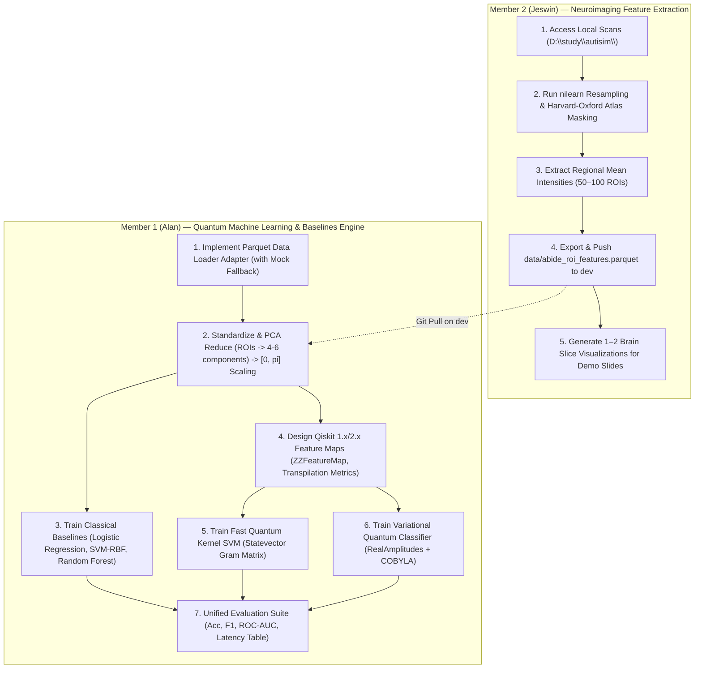

# Hackathon Roadmap & Sprint Task Board

**Project:** Quantum Machine Learning for Autism Spectrum Disorder (ASD) Classification  
**Dataset:** ABIDE I Structural Brain MRI (504 Typical Control + 500 Autism Scans)  
**Architecture:** Decoupled Neuroimaging Feature Extraction $\to$ `abide_roi_features.parquet` $\to$ QML & Classical Baselines  
**Timeline:** 10:00 AM – 04:15 PM (~4.5 hours remaining)

---

## 1. Operating Protocol & Division of Labor

---

## 2. Live Task Board

### Sprint 1: Data Handoff & Baseline Pipeline (10:00 AM – 01:30 PM)

| Task ID | Workstream | Owner | Specific Deliverables | Status |
| :--- | :--- | :--- | :--- | :---: |
| **S1-01** | Git Setup | Shared | Clean `main` & `dev` branch tracking, context docs | **Completed** |
| **S1-02** | MRI ROI Extraction | **Jeswin** | Run `nilearn` on `D:\study\autisim\`, extract Harvard-Oxford atlas ROI means across 1,004 subjects | **IN PROGRESS** |
| **S1-03** | Parquet Handoff Commit | **Jeswin** | Commit `data/abide_roi_features.parquet` (~500 KB) to `origin/dev` | **BLOCKED ON S1-02** |
| **S1-04** | Modular Data Loader | **Alan** | Build `src/data_loader.py` for `abide_roi_features.parquet` with PCA ($d=4, 6$) and $[0, \pi]$ scaling | **Ready to Build** |
| **S1-05** | Classical Baseline Harness | **Alan** | Benchmark Logistic Regression, Linear SVM, RBF SVM, Random Forest | **Ready to Build** |
| **S1-06** | Feature Map Circuit Design | **Alan** | Transpile `ZFeatureMap` & `ZZFeatureMap` (linear/full), log depth & CNOT counts | **Ready to Build** |

---

### Sprint 2: Quantum Models & Comparative Evaluation (02:00 PM – 04:00 PM)

| Task ID | Workstream | Owner | Specific Deliverables | Status |
| :--- | :--- | :--- | :--- | :---: |
| **S2-01** | Fast Quantum Kernel Estimator | **Alan** | Compute statevector Gram matrix fidelity $K_{ij} = \|\langle \phi_i\|\phi_j\rangle\|^2$, train precomputed SVM | Pending S1 |
| **S2-02** | VQC Implementation | **Alan** | `ZZFeatureMap` + `RealAmplitudes` + `COBYLA` optimizer on Qiskit Aer | Pending S1 |
| **S2-03** | QPU Noise Simulation | **Alan** | Simulate circuit on `AerSimulator` with fake IBM backend noise model | Pending S2-01 |
| **S2-04** | Diagnostic Visualizations | **Jeswin** | Confusion matrices, ROC curves, brain slice overlay plot | Pending S1-03 |
| **S2-05** | Comparative Metrics Table | Shared | Side-by-side benchmark table (Accuracy, Balanced Acc, F1, ROC-AUC, Latency) | Pending S2-02 |

---

### Final Submission & Demo (04:15 PM – 05:15 PM)

| Task ID | Workstream | Owner | Specific Deliverables | Status |
| :--- | :--- | :--- | :--- | :---: |
| **FIN-01** | Repository README | Shared | Setup instructions, Qiskit usage details, reproducibility steps | Pending Sprint 2 |
| **FIN-02** | Presentation Deck | Shared | 5-minute slide deck (Problem, Architecture, Circuits, Benchmarks, Limitations) | Pending Sprint 2 |
| **FIN-03** | Live Demo Script | Shared | Test 60-second end-to-end evaluation runbook for evaluation panel | Pending Sprint 2 |
