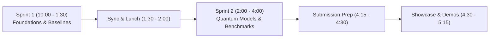

# Hackathon Roadmap & Sprint Board

This living document tracks the shared progress of Member 1 and Member 2 across the hackathon sprints.

---

## Sprint Schedule Overview

---

## Task Board

### Sprint 1: Foundations & Classical Baseline (10:00 AM – 01:30 PM)

| Task ID | Component | Owner | Deliverable | Status |
| :--- | :--- | :--- | :--- | :---: |
| **S1-01** | Git Repo & Branching Setup | Shared | Clean git structure, branch hygiene, context & skills catalog | Completed |
| **S1-02** | Data Loader & Preprocessing | Member 2 | Ingest WDBC, scale to $[0, \pi]$, PCA reduction ($d=4$) | Ready for implementation |
| **S1-03** | Classical Baselines Harness | Member 2 | Train Logistic Regression, SVM-Linear, SVM-RBF, Random Forest | Ready for implementation |
| **S1-04** | Feature Map Circuit Design | Member 1 | Implement `ZFeatureMap` and `ZZFeatureMap` in Qiskit 1.x | Ready for implementation |
| **S1-05** | Circuit Transpilation Profile | Member 1 | Measure depth, gate count, CNOT count on `AerSimulator` | Ready for implementation |

---

### Sprint 2: Quantum Models & Comparative Benchmarks (02:00 PM – 04:00 PM)

| Task ID | Component | Owner | Deliverable | Status |
| :--- | :--- | :--- | :--- | :---: |
| **S2-01** | Fast Quantum Kernel Estimator | Member 1 | Statevector Gram matrix computation, symmetry caching | Ready for implementation |
| **S2-02** | Quantum Support Vector Classifier | Member 1 | Train `SVC(kernel='precomputed')`, evaluate test predictions | Ready for implementation |
| **S2-03** | VQC Implementation & Optimization | Member 1 | `ZZFeatureMap` + `RealAmplitudes` + `COBYLA` optimizer | Ready for implementation |
| **S2-04** | Unified Evaluation Suite | Member 2 | Comparative table: Accuracy, F1, ROC-AUC, latency | Ready for implementation |
| **S2-05** | Diagnostic Visualizations | Member 2 | Confusion matrices, ROC curves, circuit diagrams | Ready for implementation |

---

### Final Submission & Demo (04:15 PM – 05:15 PM)

| Task ID | Component | Owner | Deliverable | Status |
| :--- | :--- | :--- | :--- | :---: |
| **FIN-01** | Repository README & Documentation | Shared | Setup instructions, Qiskit backend notes, dependencies | Pending Sprint 2 |
| **FIN-02** | Presentation Deck / Demo Script | Shared | 5-minute slide deck and live execution runbook | Pending Sprint 2 |
| **FIN-03** | Submission Form & Discord Check | Shared | GitHub link, project summary submitted to organizers | Pending Sprint 2 |
