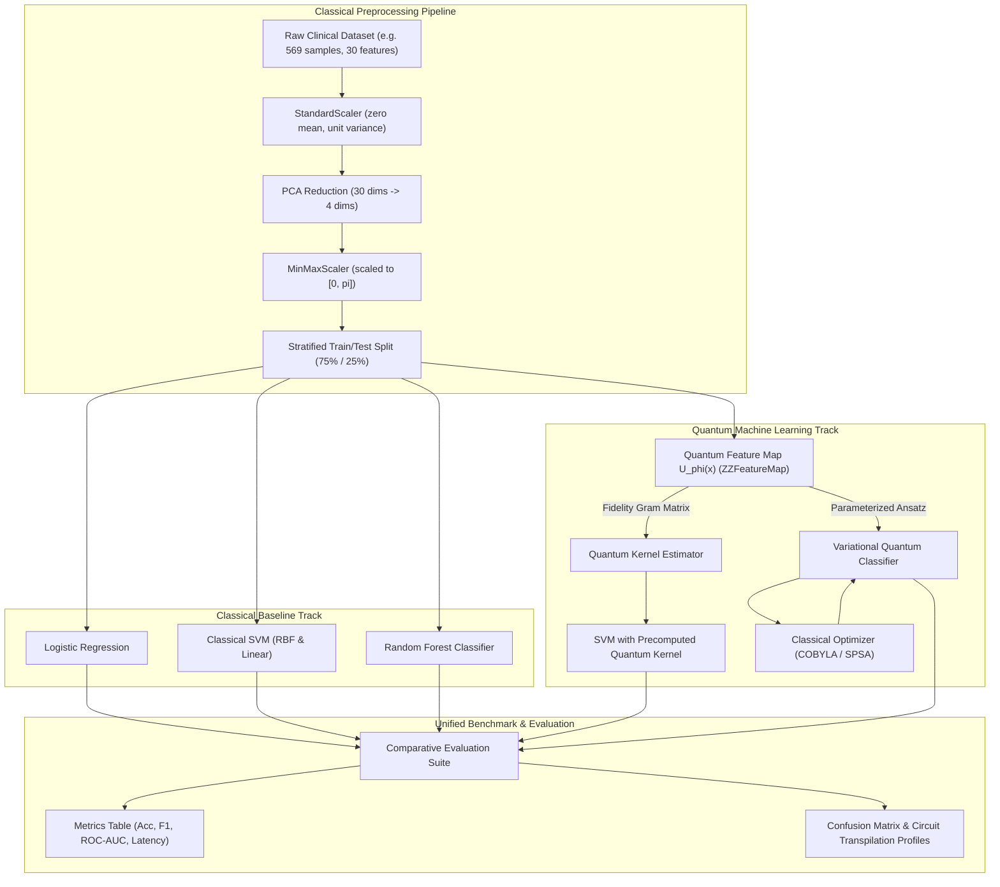

# Technical Architecture & Quantum ML Pipeline

This document details the mathematical specifications, circuit representations, and architectural flow of the disease classification pipeline.

---

## 1. High-Level System Architecture

---

## 2. Mathematical Formulations

### 2.1 Dimensionality Reduction & Encoding Bounds
Given clinical feature vector $x \in \mathbb{R}^D$ where $D = 30$ (Breast Cancer Wisconsin Diagnostic dataset):
1. **Standardization:**
   $$\tilde{x} = \frac{x - \mu}{\sigma}$$
2. **Principal Component Analysis (PCA):**
   $$z = W^T \tilde{x}, \quad z \in \mathbb{R}^n, \quad n \in \{4, 6\}$$
   where $W \in \mathbb{R}^{D \times n}$ contains the top $n$ eigenvectors maximizing explained variance ($\ge 75\%$ total variance retained with $n=4$).
3. **Phase-Safe Scaling:**
   $$x^* = \pi \cdot \frac{z - z_{min}}{z_{max} - z_{min}} \implies x^* \in [0, \pi]^n$$
   *Rationale:* Rotations in Qiskit feature maps are parameterized by angles. Bounding within $[0, \pi]$ prevents phase aliasing ($2\pi$ periodicity).

---

### 2.2 Quantum Feature Mapping (`ZZFeatureMap`)
To map $x^* \in [0, \pi]^n$ into an $n$-qubit quantum state:
$$|\phi(x^*)\rangle = U_{\Phi}(x^*) |0\rangle^{\otimes n}$$

where $U_{\Phi}(x^*)$ is generated by:
$$U_{\Phi}(x^*) = \exp\left(i \sum_{S \subseteq [n]} \phi_S(x^*) \prod_{i \in S} Z_i \right)$$

For a second-order expansion ($|S| \le 2$):
- Single-qubit rotations: $\phi_{\{i\}}(x^*) = 2 x_i^*$
- Two-qubit entangling interactions: $\phi_{\{i, j\}}(x^*) = 2(\pi - x_i^*)(\pi - x_j^*)$

In circuit terms, this corresponds to:
1. A layer of Hadamard gates: $H^{\otimes n}$
2. Single-qubit phase rotations: $R_z(2 x_i^*)$
3. Pairwise entangling blocks: $CX_{i, j} \to R_z(2(\pi - x_i^*)(\pi - x_j^*)) \to CX_{i, j}$
4. Repeating for $d$ repetitions (default $d=2$).

---

### 2.3 Quantum Support Vector Machine (QSVM / Quantum Kernel)
The transition fidelity between two encoded patient states defines the kernel:
$$K(x_i^*, x_j^*) = |\langle \phi(x_i^*) | \phi(x_j^*) \rangle|^2 = |\langle 0^{\otimes n} | U_\Phi^\dagger(x_j^*) U_\Phi(x_i^*) | 0^{\otimes n} \rangle|^2$$

Properties:
- **Symmetric:** $K(x_i^*, x_j^*) = K(x_j^*, x_i^*)$
- **Positive Semi-Definite:** Valid Mercer kernel.
- **Normalized:** $K(x_i^*, x_i^*) = 1.0$.

The dual optimization problem solved classically via `sklearn.svm.SVC`:
$$\max_{\alpha} \sum_{i=1}^N \alpha_i - \frac{1}{2} \sum_{i,j=1}^N \alpha_i \alpha_j y_i y_j K(x_i^*, x_j^*)$$
subject to $0 \le \alpha_i \le C$ and $\sum_{i=1}^N \alpha_i y_i = 0$.

---

### 2.4 Variational Quantum Classifier (VQC)
A hybrid parameterized circuit architecture:
$$|\psi(x^*, \theta)\rangle = W(\theta) U_\Phi(x^*) |0\rangle^{\otimes n}$$
where $W(\theta)$ is a variational ansatz (e.g. `RealAmplitudes` with $R_y(\theta)$ gates and linear CNOT entanglement).

- **Measurement:** Expectation value of the Pauli-$Z$ observable on qubit 0:
  $$\hat{y}(x^*) = \langle \psi(x^*, \theta) | Z_0 | \psi(x^*, \theta) \rangle \in [-1, 1]$$
- **Loss Function:** Binary cross-entropy or mean squared error.
- **Optimization:** Classical derivative-free optimizer (`COBYLA`) or simultaneous perturbation stochastic approximation (`SPSA`) over parameter space $\theta \in \mathbb{R}^p$.

---

## 3. Circuit Transpilation & Hardware Profile

Target simulator: `AerSimulator` (Qiskit 1.x)
- **Qubit Count:** 4 qubits (ideal trade-off between expressivity and interactive simulation runtime)
- **Entanglement Topology:** `entanglement='linear'` (minimizes two-qubit gate overhead: $CX$ depth is linear in $n$)
- **Gate Budget Targets:**
  - `ZZFeatureMap(reps=2)` on 4 qubits: ~8 CNOTs, depth ~12-16
  - `RealAmplitudes(reps=2)` on 4 qubits: ~6 CNOTs, depth ~8-10
  - Total VQC circuit depth: $\le 30$, total CNOTs: $\le 16$.
